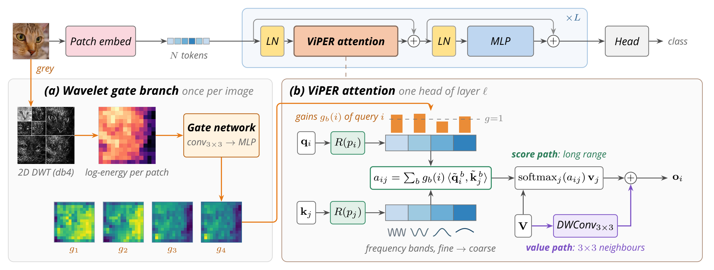

## ViPER: Vision Positional Encoding with Wavelet-Steered Rotary Bands

[](https://www.python.org/downloads/release/python-380/)
[](https://pytorch.org/)
[](https://opensource.org/licenses/MIT)
[](https://ieeexplore.ieee.org/document/11460736)

Anonymous code release for double-blind review.

<p align="center"></p>

ViPER gives attention two positional paths.

- **Score path (long range).** 2D rotary position encoding (RoPE-Mixed frequencies) whose frequency pairs are
  grouped into bands, from fine to coarse. A small wavelet branch reads the local edge energy of the image
  (4-level db4 DWT, at the image's native resolution) and outputs a gate per layer, head, token and band that
  rescales that band of the query. The gated score still depends only on the relative offset, so the encoding
  is table-free and works at any test resolution.
- **Value path (short range).** A depth-wise 3x3 convolution of the values (LePE) added to the attention output,
  which reaches the immediate neighbourhood without competing in the softmax.

<!-- RESULTS:BEGIN (generated by scripts/make_readme.py) -->
### Results

DeiT-S, 100 epochs, trained from scratch with one recipe for every encoding (on ImageNet-1k, ViPER caps the peak
learning rate of its gate branch at 1/8 of the base rate); test top-1 (%), mean over 3 seeds (± std at 224; ¹ one seed, ² two seeds). Other resolutions are evaluated without fine-tuning. Best value of each column in bold.

**ImageNet-1k**

| Method | Top-1 (224) | 160 | 288 | 384 |
|---|---:|---:|---:|---:|
| No PE | 71.65 ± 0.16 | 65.71 | 72.07 | 70.03 |
| APE (learned) | 75.01 ± 0.27 | 68.89 | 75.54 | 73.83 |
| RoPE-Mixed | 76.86 ± 0.11 | 71.90 | 77.23 | 75.55 |
| STRING | 77.04 ± 0.13 | 72.17 | 77.46 | 75.97 |
| LePE | 76.92 ± 0.07 | 72.21 | 77.51 | 75.89 |
| LookHere | 76.29 ± 0.10 | 71.80 | 77.19 | 76.52 |
| **ViPER (ours)** | **77.79 ± 0.12** | **73.50** | **78.62** | **76.70** |

**ImageNet-100.** OOD avg.: mean top-1 over ImageNet-v2, -Sketch, -R and -A restricted to the ImageNet-100
classes. PE params and inference throughput (batch 128, bf16, one GPU) on DeiT-S at 224.

| Method | Top-1 (224) | 384 | OOD avg. | PE params | Infer img/s |
|---|---:|---:|---:|---:|---:|
| No PE | 66.81 ± 0.55 | 66.07 | 23.29 | 0.0K | 3,808 |
| APE (learned) | 69.52 ± 0.55 | 67.79 | 24.74 | 75.3K | 3,734 |
| 2D sin-cos | 71.69 ± 0.62 | 64.08 | 26.60 | 0.0K | 3,750 |
| Learnable Fourier | 71.10 ± 0.16 | 69.96 | 25.73 | 57.9K | 3,706 |
| CPE / PEG | 74.31 ± 0.24 | 73.48 | 29.65 | 3.8K | 3,712 |
| LePE | 77.23 ± 0.15 | 76.70 | 33.73 | 46.1K | 3,168 |
| RPB | 69.05 ± 0.53 | 68.05 | 24.47 | 4.4K | 2,232 |
| 2D-ALiBi | 71.48 ± 0.62 | 72.49 | 26.60 | 0.0K | 2,240 |
| LookHere | 76.95 ± 0.19 | **78.51** | 32.71 | 0.0K | 2,292 |
| PaPE | 74.23 ± 0.61 | 74.38 | 30.18 | 2.77M | 1,027 |
| iRPE (contextual) | 72.50 ± 0.77 | 72.33 | 27.31² | 113.7K | 1,992 |
| CrossFormer DPB | 76.69 ± 0.99 | 77.73 | 31.39 | 18.8K | 2,244 |
| ConViT GPSA | 75.11 ± 0.48 | 76.24 | 31.40 | 75.6K | 2,036 |
| Wavelet RPE (2D port) | 75.13 ± 0.31 | 75.54 | 30.00 | 0.0K | 1,904 |
| RoPE-Axial | 76.45 ± 0.35 | 74.92 | 31.33 | 0.0K | 2,624 |
| RoPE-Mixed | 76.48 ± 0.43 | 74.53 | 31.51 | 4.6K | 2,621 |
| LieRE | 75.78 ± 0.36 | 74.07 | 30.26 | 73.7K | 1,163 |
| ComRoPE-LD | 75.29 ± 0.55 | 72.92 | 29.75 | 37.1K | 1,215 |
| STRING | 77.77 ± 0.30 | 75.27 | 32.19 | 299.5K | 2,077 |
| Spiral RoPE | 76.29 ± 0.46 | 74.69 | 31.01 | 75.3K | 2,645 |
| CARoPE (2D port) | 76.12 ± 0.64 | 75.25 | 30.74 | – | – |
| ViPER w/o gates | 78.91 ± 0.16 | 77.78 | 35.35 | 50.7K | 2,361 |
| **ViPER (ours)** | **79.38 ± 0.19** | 78.27 | **35.88** | 60.8K | 2,220 |

**Downstream.** ImageNet-100 models fine-tuned on Flowers-102, FGVC-Aircraft and DTD (top-1), and on ADE20K
semantic segmentation with a linear decoder at 512x512 (mIoU).

| Method | Flowers-102 | FGVC-Aircraft | DTD | ADE20K mIoU |
|---|---:|---:|---:|---:|
| RoPE-Mixed | 78.19 | 42.58 | 51.83 | 28.56 |
| STRING | 79.31 | 43.32 | 51.88 | 29.21 |
| LePE | 79.71 | 46.96 | 53.46 | 25.75 |
| LookHere | 79.68 | 41.99 | 52.38 | 26.82 |
| ViPER w/o gates | 80.82 | 46.94 | 53.39 | 30.31 |
| **ViPER (ours)** | **81.14** | **48.71** | **54.82** | **30.77** |
<!-- RESULTS:END -->

### Setup
```bash
conda create -n viper python=3.10 -y && conda activate viper
pip install -r requirements.txt
```

### Data
Datasets live in `data/` (override with `VIPER_DATA`).

- **ImageNet-100** (CMC 100-class split, Tian et al.), Hugging Face mirror:
  ```bash
  python -c "from huggingface_hub import snapshot_download as s; s('clane9/imagenet-100', repo_type='dataset', local_dir='data/hf/imagenet-100')"
  ```
  ImageNet-100 has no public test split: we hold out 5% of each training class (seed 42) for model selection
  and report the official validation set as test.
- **ImageNet-1k** (gated on Hugging Face: accept the terms of `ILSVRC/imagenet-1k`, then `hf auth login`).
  Streamed shard by shard into packed JPEG files (train at 256 px shorter side, about 38 GB; val unchanged):
  ```bash
  python -m scripts.prep_imagenet1k            # -> data/imagenet1k/{train,val}.bin + offsets/labels
  ```
  As for ImageNet-100, 1% of each training class is held out for model selection and val is reported as test.
- **ADE20K** (SceneParsing, 150 classes): unpack `ADEChallengeData2016.zip` from the MIT Scene Parsing
  benchmark into `data/ade20k/ADEChallengeData2016/`.
- **Flowers-102, FGVC-Aircraft, DTD** (transfer): downloaded by torchvision on first use.
- **Robustness sets** (ImageNet-v2, -Sketch, -R, -A; webdataset copies):
  ```bash
  python -c "from huggingface_hub import snapshot_download as s; [s(f'clip-benchmark/{r}', repo_type='dataset', local_dir=f'data/robust/{r}') for r in ['wds_imagenetv2','wds_imagenet_sketch','wds_imagenet-r','wds_imagenet-a']]"
  ```

### Positional encodings
All encodings share one interface (`--pe <name>`, options as JSON in `--pe_kwargs`):

| Family | `--pe` |
|---|---|
| none / absolute | `none`, `learned`, `sincos`, `fourier` |
| conditional | `cpe`, `lepe` |
| relative bias | `relbias`, `alibi`, `lookhere`, `pape`, `irpe`, `dpb`, `gpsa`, `wavelet_rpe` |
| rotary | `rope_axial`, `rope_mixed`, `liere`, `comrope_ld`, `string_cayley`, `spiral`, `carope` |
| **ours** | `viper` with `--pe_kwargs '{"lepe": true}'` |

Implementations: `viper/models/pe.py` (classic encodings and ViPER) and `viper/models/pe_extra.py` (recent
baselines, each with its source and the choices made where the source leaves them open).
`benchmark/baselines.md` documents every baseline's re-implementation and its sources (official code, paper or
checkpoint).

### Train and evaluate
```bash
# ViPER on ImageNet-100, DeiT-S, 100 epochs; evaluated on the test set at 64..448 px after training
python -m viper.train --dataset imagenet100 --backbone deit_small --pe viper --pe_kwargs '{"lepe": true}' \
    --epochs 100 --warmup 5 --bs 128 --seed 0 --out results/in100_deit_small/viper_s0

# matched control: the same model without the wavelet gates (= RoPE-Mixed + LePE)
python -m viper.train --dataset imagenet100 --backbone deit_small --pe viper \
    --pe_kwargs '{"lepe": true, "use_gate": false}' --epochs 100 --warmup 5 --bs 128 --seed 0 \
    --out results/in100_deit_small/abl_no_gates_s0

# ImageNet-1k, multi-GPU: --bs is per GPU, global batch = bs x GPUs x accum (here 1024, lr 1e-3)
python -m torch.distributed.run --nproc_per_node 2 -m viper.train --dataset imagenet1k --backbone deit_small \
    --pe viper --pe_kwargs '{"lepe": true}' --epochs 100 --warmup 5 --bs 256 --accum 2 --workers 10 --seed 0 \
    --out results/in1k_deit_small/viper_s0

# gate-source controls: static gates (no image input) and gates from a learned RGB patch filter
python -m viper.train ... --pe viper --pe_kwargs '{"lepe": true, "gate_src": "static"}' ...
python -m viper.train ... --pe viper --pe_kwargs '{"lepe": true, "gate_src": "rgb"}' ...

# transfer: fine-tune an ImageNet-100 checkpoint on a small dataset (new classifier, everything else loaded)
python -m viper.train --dataset flowers102 --backbone deit_small --pe viper --pe_kwargs '{"lepe": true}' \
    --init results/in100_deit_small/viper_s0/best.pt --epochs 100 --warmup 5 --bs 64 --lr 1e-4 --no_multires \
    --seed 0 --out results/transfer/flowers102/viper_s0

# ADE20K segmentation: fine-tune an ImageNet-100 checkpoint (Segmenter linear decoder, 512x512)
python -m viper.seg --init results/in100_deit_small/viper_s0 --seed 0 --out results/ade20k_deit_small/viper_s0
```
Each classification run writes `config.json`, `history.json`, `final.json` (metrics at every test
resolution), `preds.npz` (per-image logits for the significance tests) and `best.pt`. Runs resume from
`last.pt` if interrupted.

### Reproduce the paper
```bash
python scripts/make_jobs.py main        # all baselines, seeds 0-2
python scripts/make_jobs.py viper       # ViPER, matched control and gate controls (seeds 0-4) + ablations (seeds 0-1)
python scripts/make_jobs.py deit_tiny   # smaller backbone (seeds 0-2)
python scripts/make_jobs.py deit_base   # larger backbone (seed 0)
python scripts/make_jobs.py transfer    # Flowers-102, FGVC-Aircraft, DTD fine-tuning (seeds 0-2)
python scripts/make_jobs.py ade20k      # segmentation fine-tuning
python scripts/queue.py 'jobs/*.json' --gpus 0,1,2 --max_per_gpu 2     # resumable multi-GPU job queue

python -m scripts.efficiency --pes 'none;rope_mixed;viper=viper:{"lepe": true}' --out results/efficiency_deit_small.json
python -m scripts.robust_eval cache && python -m scripts.robust_eval eval      # ImageNet-v2/Sketch/R/A
python -m scripts.analysis gates && python -m scripts.analysis attn           # gate statistics, attention distance
python -m scripts.texture_gain                                                 # gain of the gates per image-texture quintile
python -m scripts.probe_position results/in100_deit_small/viper_s0             # coordinate probing

python scripts/make_tables.py           # LaTeX tables and number macros (mean ± std, paired tests)
python scripts/make_figures.py          # figures
```

### License
MIT
